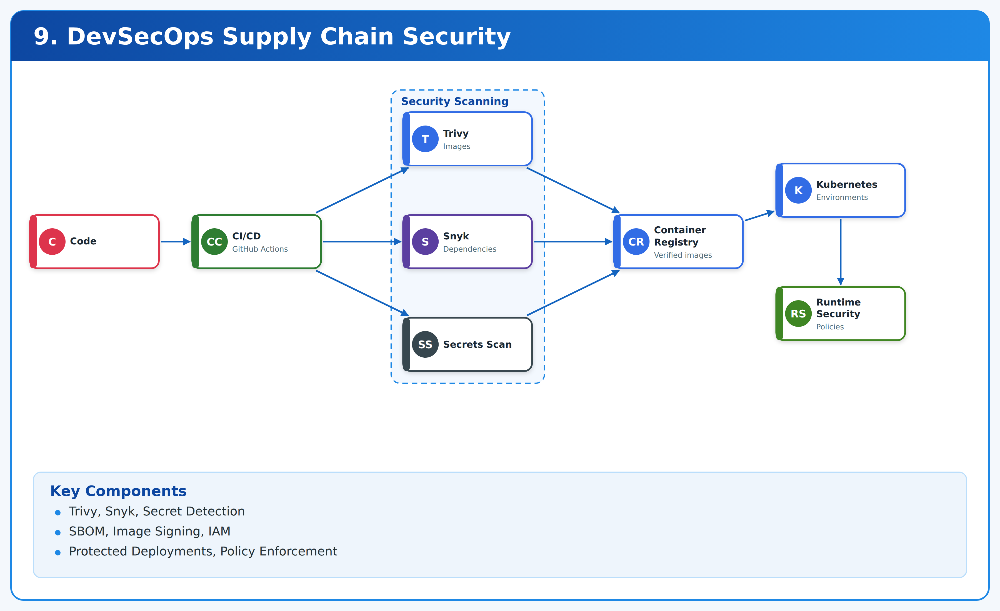
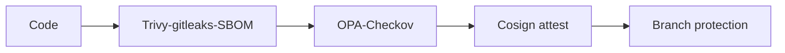

# 09. DevSecOps Supply Chain Security



**Trivy · SBOM · Sigstore** · *Phase 1 foundations + Phase 5 readiness* · `lab`.

> Trivy + deps + gitleaks + Syft/Grype SBOM + cosign attest + OPA/Checkov + branch protection. Reusable workflow consumed by all repos.

## Contents

1. Outcomes 2. Architecture 3. Prerequisites 4. Repo map 5. Step 0 clone 6. Step 1 Trivy fs/config 7. Step 2 gitleaks + deps 8. Step 3 SBOM + sign 9. Step 4 IaC policy 10. Step 5 consume reusable workflow 11. Severity gates 12. Teardown 13. Troubleshooting

## 1. Outcomes

- Every PR scanned: fs/config, secrets, IaC misconfig.
- SBOM artifact per build, image signed, critical = block.
- `SECURITY.md` reporting path.

## 2. Architecture



## 3. Prerequisites

- docker, trivy (`brew install aquasecurity/trivy/trivy`), gitleaks (`brew install gitleaks`), syft/grype, cosign, checkov (`pip3 install checkov`), opa optional.

## 4. Repository map

```
.github/workflows/security.yml           # Trivy fs + gitleaks (PR + weekly)
.github/workflows/security-reusable.yml # workflow_call template
policy/block-critical.rego              # example deny
SECURITY.md
```

## Step 0 — Clone

```bash
git clone https://github.com/navin-kumar10/devsecops-supply-chain-security.git
cd devsecops-supply-chain-security
bash tests/smoke.sh
cat .github/workflows/security.yml policy/block-critical.rego
```

## Step 1 — Scan filesystem and config

```bash
trivy fs --severity HIGH,CRITICAL --format table .
trivy config --severity HIGH,CRITICAL terraform/ 2>/dev/null || trivy config .
# expected: no CRITICAL for lab; fix or document exceptions
```

Update DB: `trivy image --download-db-only`.

## Step 2 — Secrets + dependencies

```bash
gitleaks detect --source . -v
npm audit --audit-level=high 2>&1 | head -20 || echo "node optional"
pip3 install pip-audit 2>/dev/null; pip-audit 2>&1 | head -20 || echo "pip-audit optional"
```

If gitleaks flags history, rotate secret, purge with BFG, force-push branch only.

## Step 3 — SBOM and signing (image repos)

```bash
syft packages dir:. -o spdx-json=sbom.json && head -c 300 sbom.json; echo
grype sbom:sbom.json --fail-on critical 2>&1 | head -20 || true
# sign after push:
# cosign sign --yes registry.example.com/app:v0.1.0
# cosign attest --predicate sbom.json registry.example.com/app:v0.1.0
cosign --version 2>&1 | head -2 || echo "install cosign for prod"
```

## Step 4 — IaC policy

```bash
checkov -d terraform 2>&1 | head -30 || checkov -d . 2>&1 | head -30 || echo "add TF to extend"
cat policy/block-critical.rego
```

Promote `deny` on `CRITICAL` with documented waiver process (expiry + owner).

## Step 5 — Reuse in every repo

```yaml
# in consumer repo .github/workflows/security-consume.yml
name: security-consume
on: {pull_request: {}}
jobs:
  sec:
    uses: navin-kumar10/devsecops-supply-chain-security/.github/workflows/security-reusable.yml@main
```

Verify: open test PR with vulnerable dep → check fails → fix → green.

## Severity gates

- `CRITICAL`: block merge, fix <24h.
- `HIGH`: block unless waiver with expiry.
- Secrets: block always.

## Teardown

No infra. `rm -f sbom.json`. Revoke leaked creds if found.

## Troubleshooting

| Symptom | Cause | Fix |
|---|---|---|
| Trivy DB old | cache | `trivy image --download-db-only`, `trivy clean --all` selective |
| gitleaks false positive | allowlist | `.gitleaks.toml` allow with comment + review |
| Checkov many lows | noisy | `--skip-check` only with ticket, focus HIGH/CRITICAL |

Security consumed, not bolted on. MIT — LICENSE.
